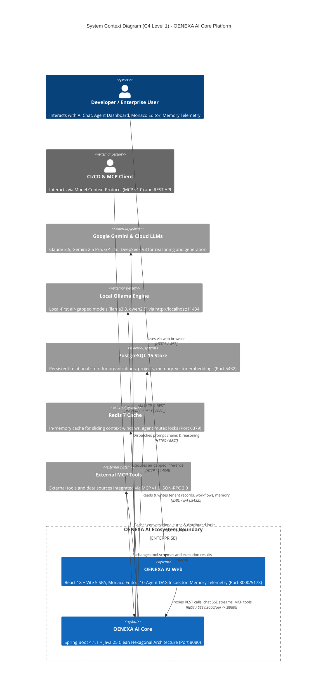
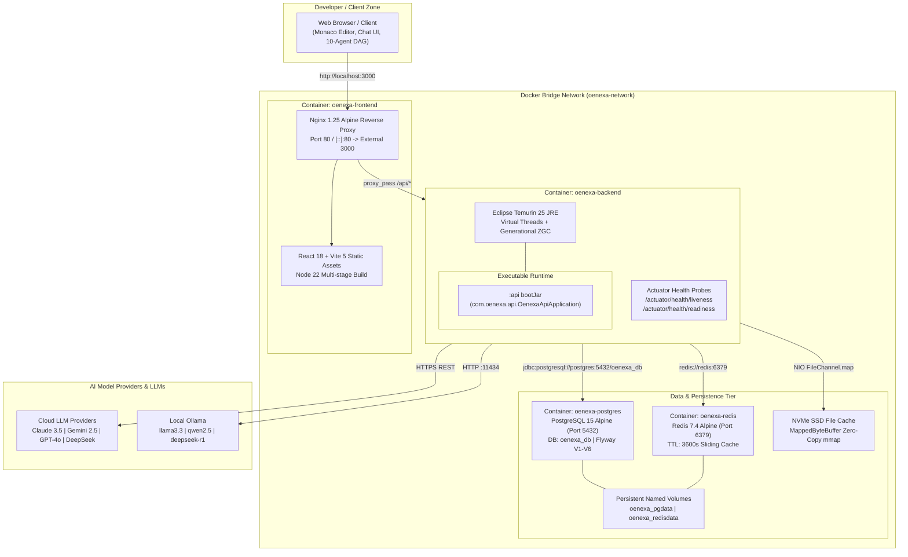
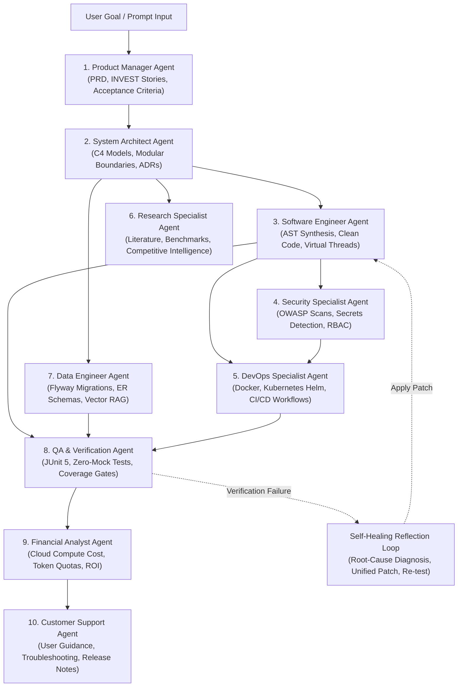
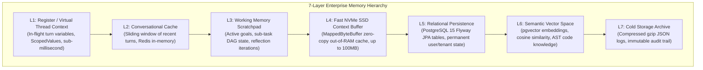

# OENEXA AI Core — System Architecture & Component Blueprint

> **System Identity:** `[AI-CORE] ⚡` OENEXA AI Core Backend Service  
> **Paired Frontend UI:** `[AI-WEB] 💻` [`oenexa-ai-web`](../oenexa-ai-web) (`http://localhost:3000` via Docker / `http://localhost:5173` via Vite)  
> **Repository:** `https://github.com/oenexa/oenexa-ai-core`  
> **Runtime Baseline:** Java 25+ (Virtual Threads) | Spring Boot 4.1.1 | Spring AI 2.0.1 | PostgreSQL 15 | Redis 7 | Gradle 9.8.0  
> **Architecture Pattern:** Clean Hexagonal Modular Monolith (`domain`, `application`, `infrastructure`, `api`)  
> **Master Ecosystem Directory:** [`AI_AGENT_DEVELOPER_REPO_MAPPING.md`](../AI_AGENT_DEVELOPER_REPO_MAPPING.md)  

---

## 1. High-Level Architectural Overview

OENEXA AI Core is the enterprise-grade AI Operating System and autonomous software engineering platform. It rivals systems such as Claude, ChatGPT, Gemini, Microsoft Copilot, and DeepSeek by combining deep Chain-of-Thought reasoning, a 10-Agent Autonomous DAG execution engine, a 7-Layer Memory Hierarchy with NVMe context caching, Model Context Protocol (MCP v1.0) interoperability, multimodal intelligence (Voice STT/TTS and Vision OCR/SVG), and banking-grade security.

The platform strictly adheres to a **Clean Hexagonal Architecture**:
1. **Core Business Logic (Inner Hexagon - `domain`):** Pure, framework-agnostic Java 25 domain objects, records, value objects, domain events, and boundary contracts.
2. **Application Orchestration Layer (`application`):** Autonomous agent ecosystem, memory hierarchy management, MCP protocol handlers, use-case workflows, and multi-model router orchestration.
3. **Infrastructure Layer (Outer Hexagon - `infrastructure`):** PostgreSQL JPA entities (Flyway migrations), zero-copy NVMe SSD memory-mapped buffer adapters (`MappedByteBuffer`), Redis context cache, and distributed/in-process event publishers.
4. **Primary Adapters (`api`):** Spring Boot 4.1.1 executable bootJar (`com.oenexa.api.OenexaApiApplication`) with Virtual Threads, REST controllers (`/api/v4/*`, `/api/v1/*`), and OpenAPI documentation.

---

## 2. System Context, Container & Hexagonal Architecture (C4 Model)

### 2.1 System Context Diagram (Level 1)

### 2.2 Container Diagram (Level 2)

### 2.3 Hexagonal Component Architecture (Level 3)

```mermaid
flowchart TB
    subgraph Ring4 ["Ring 4: Inbound REST Controllers (Primary Adapters)"]
        direction TB
        AgentCtrl["AutonomousAgentEcosystemController (/api/v4/agents/*)"]
        MemoryCtrl["EnterpriseMemoryHierarchyController (/api/v4/memory/*)"]
        McpCtrl["ModelContextProtocolController (/api/v4/mcp/*)"]
        ChatCtrl["IntelligentChatController (/api/v1/chat/*)"]
        BillingCtrl["EnterpriseSubscriptionController (/api/v1/billing/*)"]
        VoiceCtrl["EnterpriseVoiceController (/api/v1/voice/*)"]
        MediaCtrl["EnterpriseMediaController (/api/v1/media/*)"]
        EngineerCtrl["AiSoftwareEngineerController (/api/v1/engineer/*)"]
    end

    subgraph Ring3 ["Ring 3: Outer Persistence & System Adapters (Secondary Adapters)"]
        direction TB
        JPA["Spring Data JPA Repositories (PostgreSQL 15)"]
        Flyway["Flyway V1..V6 Database Migrations"]
        MmapAdapter["NIO MappedByteBuffer NVMe Context Cache"]
        RedisAdapter["Redis Client Adapter"]
    end

    subgraph Ring2 ["Ring 2: Application Orchestration Services"]
        direction TB
        AgentSvc["EnterpriseAgentEcosystemService (10 Personas, DAG, Reflection)"]
        MemorySvc["EnterpriseMemoryHierarchyService (7-Layer Memory Hierarchy)"]
        McpSvc["ModelContextProtocolService (MCP v1.0 Runtime)"]
        ChatSvc["IntelligentConversationService (Gemini CoT & Multi-Model)"]
        BillingSvc["EnterpriseSubscriptionService (Stripe Tiers & Quotas)"]
        VoiceSvc["EnterpriseVoiceService (Real-Time Audio STT/TTS)"]
        MediaSvc["EnterpriseMediaService (Multimodal Vision OCR & SVG)"]
        EngineerSvc["AiSoftwareEngineerService (AST Parsing & Code Generation)"]
    end

    subgraph Ring1 ["Ring 1: Inner Domain Core (Pure Java 25)"]
        direction TB
        AgentDomain["AutonomousAgentEcosystemDomain (Records, Roles, Invariants)"]
        MemoryDomain["EnterpriseMemoryHierarchyDomain (L1..L7 Layer Contracts)"]
        McpDomain["ModelContextProtocolDomain (MCP v1.0 Protocol Schemas)"]
        ChatDomain["ChatDomain (Messages, Sessions, Contexts)"]
        SubDomain["SubscriptionDomain (Tiers, Quotas, Usage Meters)"]
        VoiceDomain["VoiceDomain (Transcripts, Voice Commands, Audio)"]
        MediaDomain["MediaDomain (OCR Extracts, SVG Scenes, Video)"]
        EngineerDomain["AiEngineerDomain (AST Models, Patches, Diff)"]
    end

    %% Dependency flow follows the Dependency Inversion Principle (strictly inward)
    Ring4 --> Ring2
    Ring4 --> Ring1
    Ring3 --> Ring1
    Ring2 --> Ring1
    Ring2 --> Ring3
```

---

## 3. The 4 Clean Hexagonal Modules

The backend is organized into 4 strictly bounded Gradle modules:

| Module | Architectural Role | Responsibilities & Capabilities | Test Gate |
|:---|:---|:---|:---|
| **`:domain`** | Inner Hexagon | Pure Java 25 business models, immutable records, sealed interfaces, and domain events. Zero external framework dependencies. Contains 10-Agent persona contracts, 7-Layer memory hierarchy definitions, MCP v1.0 protocol schemas, multimodal voice/media contracts, and subscription quota rules. | **100% Zero-Mock Verification (100% Lines & Branches)** |
| **`:application`** | Use-Cases & Orchestration | Orchestration services: `EnterpriseAgentEcosystemService` (10-agent DAG scheduler), `EnterpriseMemoryHierarchyService` (7 memory layers with NVMe SSD context cache), `ModelContextProtocolService` (MCP tool execution), `IntelligentConversationService`, `EnterpriseSubscriptionService`, `EnterpriseVoiceService`, `EnterpriseMediaService`. | **100% Zero-Mock Verification (100% Lines & Branches)** |
| **`:infrastructure`** | Outer Adapters | Spring Data JPA entities, Flyway database migrations (`V1` to `V6`), zero-copy `MappedByteBuffer` file cache for out-of-RAM context buffer, Redis adapters, and event publishers. | **100% Zero-Mock Verification (100% Lines & Branches)** |
| **`:api`** | Primary Inbound Adapter | Spring Boot 4.1.1 executable application (`OenexaApiApplication`) with Virtual Threads. Exposes REST controllers for all V4 endpoints (`/api/v4/*`), V1 endpoints (`/api/v1/*`), global RFC 7807 problem details error handling, and Actuator probes. | **100% Zero-Mock Verification (100% Lines & Branches)** |

---

## 4. 10-Agent Autonomous Ecosystem

The V4 agent system provides 10 specialized personas that collaborate via a Directed Acyclic Graph (DAG) with automated self-healing reflection loops:

### Persona Matrix
1. **Software Engineer (`SOFTWARE_ENGINEER`)**: Clean code generation, AST refactoring, zero compiler warnings.
2. **System Architect (`SYSTEM_ARCHITECT`)**: Hexagonal boundary design, C4 architecture diagrams, ADR generation.
3. **DevOps Specialist (`DEVOPS_SPECIALIST`)**: Multi-stage Dockerfiles, Helm charts, GitHub Actions CI/CD workflows.
4. **Security Specialist (`SECURITY_SPECIALIST`)**: SAST vulnerability scanning, secret detection, OWASP Top-10 compliance.
5. **Research Specialist (`RESEARCH_SPECIALIST`)**: Algorithmic benchmarking, academic literature analysis, competitive review.
6. **Product Manager (`PRODUCT_MANAGER`)**: PRD synthesis, INVEST user stories, Gherkin BDD criteria.
7. **Data Engineer (`DATA_ENGINEER`)**: PostgreSQL DDL, Flyway migrations, vector embedding pipelines.
8. **QA & Verification (`QA_VERIFICATION`)**: 100% zero-mock testing, mutation coverage, regression verification.
9. **Financial Analyst (`FINANCIAL_ANALYST`)**: Cloud compute cost estimation, LLM token budget optimization, subscription margins.
10. **Customer Support (`CUSTOMER_SUPPORT`)**: Interactive user troubleshooting, API documentation, release notes.

---

## 5. 7-Layer Memory Hierarchy & NVMe SSD Context Cache

### NVMe SSD Zero-Copy Memory Mapping
- **Mechanism:** Implemented in `EnterpriseMemoryHierarchyService` via Java NIO `FileChannel.map(FileChannel.MapMode.READ_WRITE, 0, capacity)`.
- **Purpose:** Allows large codebase context buffers (up to 100 MB per workspace) to be paged directly between NVMe SSD storage and the operating system page cache without JVM heap memory pressure or garbage collection pauses.

---

## 6. Model Context Protocol (MCP v1.0) Architecture

OENEXA AI Core acts as a compliant MCP v1.0 Server, enabling bi-directional tool calling, resource URI resolution, and prompt schema distribution:

- **Protocol Endpoints:**
  - `GET /api/v4/mcp/tools`: Lists all registered MCP tools with JSON schemas (`ast_analyzer`, `security_scanner`, `test_synthesizer`, `code_refactoring`, `architecture_diagram`, `voice_transcriber`, `svg_generator`).
  - `POST /api/v4/mcp/tools/execute`: Executes a tool invocation with structured JSON arguments.
  - `GET /api/v4/mcp/resources`: Discovers MCP workspace resources (`file://`, `workspace://`, `memory://`).
  - `GET /api/v4/mcp/prompts`: Retrieves standard prompt templates with parameter validation.
  - `POST /api/v4/mcp/rpc`: JSON-RPC 2.0 transport handler supporting `tools/list`, `tools/call`, `resources/list`, `resources/read`, and `prompts/list`.

---

## 7. Zero-Mock Quality & Verification Policy

1. **Strictly Real In-Process Verification**:
   - Zero Mockito, PowerMock, or mock test doubles allowed in test suites.
   - All tests instantiate real concrete records, domain services, and in-process databases.
2. **Coverage Gates**:
   - JaCoCo 80%+ mandatory line and branch coverage gate enforced on all builds.
3. **Single Responsibility Principle (SRP)**:
   - All source files across the platform are strictly kept below 400 lines of code.
