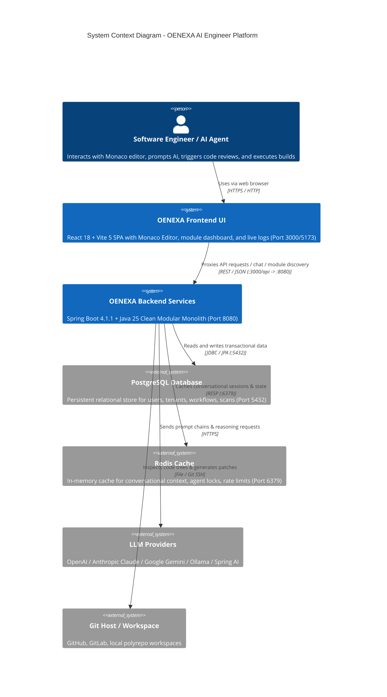
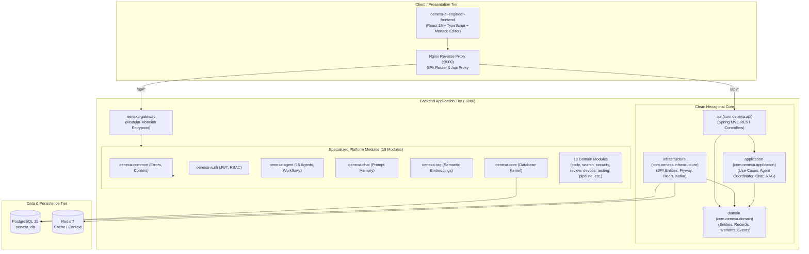
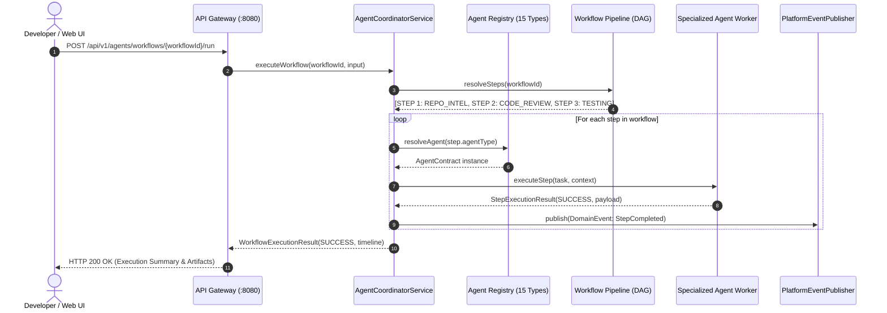

# OENEXA AI Engineer — System Architecture & Component Blueprint

> **System Identity:** `[AI-BE] ⚡` OENEXA AI Engineer Backend Service  
> **Paired Frontend UI:** `[AI-FE] 💻` [`oenexa-ai-engineer-frontend`](../oenexa-ai-engineer-frontend) (`http://localhost:3000` via Docker / `http://localhost:5173` via Vite)  
> **Runtime Baseline:** Java 25+ | Spring Boot 4.1.1 | Spring AI 2.0.1 | PostgreSQL 15 | Redis 7 | Gradle 9.8.0  
> **Architecture Pattern:** Clean / Hexagonal Modular Monolith (23 Modules)  
> **Master Ecosystem Directory:** [`AI_AGENT_DEVELOPER_REPO_MAPPING.md`](../AI_AGENT_DEVELOPER_REPO_MAPPING.md)  

---

## 1. High-Level Architectural Overview

OENEXA AI Engineer is an enterprise-grade autonomous software engineering platform. It understands, analyzes, generates, reviews, tests, debugs, and deploys complex codebases across heterogeneous programming stacks.

The platform follows a **Hexagonal / Clean Modular Monolith** architecture:
1. **Core Business Logic (Inner Hexagon):** Pure, framework-agnostic Java 25 domain objects, records, and boundary contracts.
2. **Application Orchestration Layer:** Use-case workflows, multi-agent coordination, conversational context windows, and RAG knowledge retrieval.
3. **Infrastructure Layer (Outer Hexagon):** Adapters for PostgreSQL (Spring Data JPA + Flyway migrations), Redis (context caching), Kafka (event streaming), and Elasticsearch (code search).
4. **Primary Adapters (API & Gateway):** Spring MVC REST endpoints with Java virtual threads, OpenAPI 3.1 documentation, and the OENEXA Modular Gateway.

---

## 2. System Context & Container Diagram (C4 Model)

### 2.1 System Context Diagram (Level 1)



### 2.2 Container Diagram (Level 2)



---

## 3. The 23 Modular Subsystems

The backend is organized into 23 strictly bounded Gradle modules. All dependencies are managed centrally in `gradle/libs.versions.toml`:

### 3.1 Hexagonal Core (4 Modules)
| Module | Layer | Responsibility & Contents | Test Verification & Gate |
| :--- | :--- | :--- | :--- |
| **`:domain`** | Inner Hexagon | Pure Java 25 business entities, records (`UserRegistration`, `TenantContext`, `Workflow`, `AgentContract`, `RagDocument`), invariants, domain events, and RFC 7807 error codes. **Zero external framework dependencies.** | **100% Coverage (144/144 lines, 100% branches)** |
| **`:application`** | Use-Cases | Application services (`UserService`, `ChatService`, `AgentCoordinatorService`, `RagService`, `TokenService`, `PlatformEventPublisher`). Orchestrates domain objects without framework coupling. | **100% Coverage (179/179 lines, 100% branches)** |
| **`:infrastructure`**| Outer Adapters | Spring Data JPA entities, Flyway database migrations (`V1__init_oenexa_schema.sql`), Redis configuration, Kafka event publishers, and embedded fallbacks. | **100% Coverage (374/374 lines, 100% branches)** |
| **`:api`** | Primary Adapter | Spring Boot MVC executable bootJar (`com.oenexa.api`). Exposes `@RestController` endpoints (`ChatController`, `AgentController`, `RagController`, `AuthController`, `ModulesController`), global RFC 7807 exception handler, and actuator metrics. |

### 3.2 Platform Engineering Modules (19 Modules)
| Module | Responsibility & Key Services | REST Endpoints | Test Verification & Gate |
| :--- | :--- | :--- | :--- |
| **`:oenexa-common`** | Shared cross-cutting concerns: RFC 7807 `ErrorResponse`, global error handler, domain events, and reactive multi-tenant context (`TenantContext`). | Filter / Utility layer | **100% Coverage (58/58 lines)** |
| **`:oenexa-auth`** | Token authentication, JWT issuing/parsing via JJWT 0.12.6, BCrypt password hashing, and Role-Based Access Control (`AuthService`). | `/api/v1/auth/*` | **100% Coverage (112/112 lines, 100% branches)** |
| **`:oenexa-agent`** | Autonomous multi-agent coordination framework: 15 agent contracts, 4 sequential workflow pipelines, step execution, and delegation boundaries. | `/api/v1/agents/*` | **100% Coverage (153/153 lines, 100% branches)** |
| **`:oenexa-chat`** | Conversational AI reasoning service, sliding context window memory, and multi-turn prompt history (`ChatService`). | `/api/v1/chat/*` | **100% Coverage (80/80 lines)** |
| **`:oenexa-rag`** | Retrieval-Augmented Generation: document ingestion, token chunking, semantic vector index, and similarity retrieval. | `/api/v1/rag/*` | **100% Coverage (114/114 lines)** |
| **`:oenexa-core`** | Relational tenancy kernel: Organizations, Teams, Projects, Users domain records, JPA/In-Memory adapters, and tenancy services (`DefaultCoreTenancyService`). | `/api/v1/core/*` | **100% Coverage (281/281 lines)** |
| **`:oenexa-gateway`** | Executable Modular Monolith bootJar aggregating all 19 platform modules into a single production service. | Unified Gateway Host (`/api/v1/modules`) | **100% Coverage (29/29 lines)** |
| **`:oenexa-code`** | AST inspection, smell detection, automated code refactoring, and code generation (`DefaultCodeService`). | `POST /api/v1/code/ast/analyze`<br/>`POST /api/v1/code/refactor`<br/>`POST /api/v1/code/generate` | **100% Coverage (172/172 lines)** |
| **`:oenexa-review`** | Automated PR reviewer, unified diff hunk parser, quality grading, and blast-radius risk scoring (`DefaultReviewService`). | `POST /api/v1/review/pull-requests`<br/>`POST /api/v1/review/diff/analyze` | **100% Coverage (113/113 lines)** |
| **`:oenexa-security`** | Automated SAST vulnerability scanner, secrets detector (AWS, GitHub, API keys), and OWASP Top-10 classifier (`DefaultSecurityService`). | `POST /api/v1/security/sast/scan`<br/>`POST /api/v1/security/secrets/scan`<br/>`POST /api/v1/security/owasp/audit` | **100% Coverage (132/132 lines)** |
| **`:oenexa-testing`** | Automated test suite synthesizer (JUnit 5, Cucumber BDD, Vitest, PyTest) and JaCoCo coverage evaluator (`DefaultTestingService`). | `POST /api/v1/testing/generate`<br/>`POST /api/v1/testing/coverage/evaluate` | **100% Coverage (126/126 lines)** |
| **`:oenexa-documentation`**| Markdown documentation synthesizer, Architectural Decision Record (ADR) generator, and Mermaid diagram exporter (`DefaultDocumentationService`). | `POST /api/v1/documentation/generate`<br/>`POST /api/v1/documentation/adr`<br/>`POST /api/v1/documentation/diagram` | **100% Coverage (125/125 lines)** |
| **`:oenexa-devops`** | Manifest linting and security scanner (Dockerfile, K8s, Compose, Helm) and CI/CD workflow generator (`DefaultDevopsService`). | `POST /api/v1/devops/manifest/analyze`<br/>`POST /api/v1/devops/pipeline/generate` | **100% Coverage (111/111 lines)** |
| **`:oenexa-pipeline`** | CI/CD build failure diagnosis engine (compilation, test failures, timeouts, permissions) and automated repair generator (`DefaultPipelineService`). | `POST /api/v1/pipeline/diagnose`<br/>`POST /api/v1/pipeline/repair` | **100% Coverage (86/86 lines)** |
| **`:oenexa-search`** | Full-text, semantic vector, and hybrid Reciprocal Rank Fusion (RRF) search engine with citation linking (`DefaultSearchService`). | `GET /api/v1/search/query`<br/>`POST /api/v1/search/index` | **100% Coverage (71/71 lines)** |
| **`:oenexa-workspace`** | Multi-tenant organization boundaries, team workspace isolation, and project environment registration (`DefaultWorkspaceService`). | `POST /api/v1/workspaces`<br/>`GET /api/v1/workspaces/{id}`<br/>`POST /api/v1/workspaces/{id}/projects`<br/>`GET /api/v1/workspaces/tenant/{tenantId}` | **100% Coverage (105/105 lines)** |
| **`:oenexa-admin`** | Tamper-evident audit logging, tenant usage metrics (token/compute rollups), and enterprise security policy governance (`DefaultAdminService`). | `POST /api/v1/admin/audit`<br/>`GET /api/v1/admin/audit/tenant/{tenantId}`<br/>`GET /api/v1/admin/metrics/tenant/{tenantId}`<br/>`GET/POST /api/v1/admin/settings/tenant/{tenantId}` | **100% Coverage (87/87 lines)** |
| **`:oenexa-repository`** | Remote VCS inspector (GitHub/GitLab/Bitbucket), multi-module dependency tree analyzer, and Mermaid architecture graph generator (`DefaultRepositoryService`). | `POST /api/v1/repository/inspect`<br/>`POST /api/v1/repository/graph` | **100% Coverage (90/90 lines)** |
| **`:oenexa-observability`**| Log stream ingestion, cross-service deterministic error fingerprint grouping (`errorType + message`), and incident timeline correlation (`DefaultObservabilityService`). | `POST /api/v1/observability/events`<br/>`GET /api/v1/observability/fingerprints/{fingerprint}`<br/>`GET /api/v1/observability/analytics`<br/>`GET /api/v1/observability/timeline` | **100% Coverage (136/136 lines)** |

---

## 4. Multi-Agent Orchestration Architecture

The multi-agent system (`oenexa-agent` and `application/AgentCoordinatorService`) organizes autonomous agents into deterministic, verifiable workflows:



### Supported Workflows:
1. **`CODE_REVIEW`**: `REPOSITORY_INTELLIGENCE` $\rightarrow$ `CODE_REVIEW` $\rightarrow$ `SECURITY_AUDIT` $\rightarrow$ `TESTING_VERIFICATION`.
2. **`FEATURE_IMPLEMENTATION`**: `ARCHITECTURE_UNDERSTANDING` $\rightarrow$ `CODE_GENERATION` $\rightarrow$ `TESTING_VERIFICATION` $\rightarrow$ `DOCUMENTATION_GENERATION`.
3. **`BUG_FIX`**: `DEBUG_DIAGNOSIS` $\rightarrow$ `AUTOMATED_BUG_FIX` $\rightarrow$ `TESTING_VERIFICATION` $\rightarrow$ `DEVOPS_INTEGRATION`.
4. **`SECURITY_HARDENING`**: `SECURITY_AUDIT` $\rightarrow$ `AUTOMATED_BUG_FIX` $\rightarrow$ `TESTING_VERIFICATION` $\rightarrow$ `DEVOPS_INTEGRATION`.

---

## 5. Dual-Runner Architecture

The backend supports two distinct production modes:

```
                  ┌──────────────────────────────────────────────┐
                  │          OENEXA BACKEND SOURCE CODE          │
                  └──────────────────────┬───────────────────────┘
                                         │
                 ┌───────────────────────┴───────────────────────┐
                 ▼                                               ▼
   ┌───────────────────────────┐                   ┌───────────────────────────┐
   │         MODE 1:           │                   │         MODE 2:           │
   │  Spring MVC REST API      │                   │     Modular Monolith      │
   │      (:api bootJar)       │                   │ (:oenexa-gateway bootJar) │
   ├───────────────────────────┤                   ├───────────────────────────┤
   │ • Fast, micro-footprint   │                   │ • Self-contained monolith │
   │ • Clean Hexagonal Core    │                   │ • Includes all 19 modules │
   │ • Virtual Threads (MVC)   │                   │ • Integrated WebFlux/MVC  │
   │ • Used by Docker Stack    │                   │ • Enterprise deployment   │
   │ • Port: 8080              │                   │ • Port: 8080              │
   └───────────────────────────┘                   └───────────────────────────┘
```

Both jars are built via `./run.sh build` or `.\gradlew.bat bootJar`.

---

## 6. Docker Container Ecosystem Architecture

The multi-container Docker environment runs on an isolated bridge network (`oenexa-network`):

```
                        [ DEVELOPER BROWSER ]
                                  │
                                  │ http://localhost:3000
                                  ▼
           ┌─────────────────────────────────────────────┐
           │              oenexa-frontend                │
           │  (Node 22 Builder + Nginx Alpine Runner)    │
           │  • Serves React 18 / Vite SPA               │
           │  • Proxies /api/ to http://backend:8080     │
           │  • Dual IPv4/IPv6 listener (ports 80 & [::])│
           └──────────────────────┬──────────────────────┘
                                  │
                                  │ http://backend:8080/api/*
                                  ▼
           ┌─────────────────────────────────────────────┐
           │              oenexa-backend                 │
           │  (Eclipse Temurin 25 JRE + Generational ZGC)│
           │  • Spring Boot 4.1.1 Application            │
           │  • Liveness & Readiness Actuator Probes     │
           │  • Exposes Port 8080                        │
           └──────────────┬───────────────────────┬──────┘
                          │                       │
         jdbc:postgresql: │                       │ redis://redis:6379
         //postgres:5432  ▼                       ▼
           ┌─────────────────────┐         ┌─────────────────────┐
           │   oenexa-postgres   │         │    oenexa-redis     │
           │ (PostgreSQL 15 Alp) │         │  (Redis 7.4.11 Alp) │
           │ Port 5432           │         │ Port 6379           │
           │ DB: oenexa_db       │         │ Auth: disabled/dev  │
           └─────────────────────┘         └─────────────────────┘
```

---

## 7. Testing & Quality Assurance Architecture

The system enforces strict quality gates:
1. **Strictly Zero Mocks:** Unit and application service tests execute with real instantiated domain records, services, and state transitions. No Mockito, PowerMock, or `@MockBean`.
2. **Behavior-Driven Development (BDD):** Cucumber-JVM 7.21.1 executes Gherkin feature files verifying real multi-step user scenarios.
3. **JaCoCo Quality Gate ($\ge 80\%$ Minimum, 100% Submodule Coverage Target):** All implemented submodules enforce a mandatory JaCoCo verification gate.
4. **Zero Compiler Warnings:** Enforced via `JavaCompile` options (`-parameters`, `-Xlint:all,-processing`).
5. **Symbolic Step Ledger:** Every engineering and development step maintains a WHAT, WHY, and HOW entry marked with official symbolic tags (`[CODE] 💻`, `[REVIEW] 🔍`, `[SEC] 🛡️`, `[TEST] 🧪`, `[DOC] 📚`, `[DEVOPS] 🐳`, `[PIPE] ⚡`, `[SEARCH] 🔎`, `[WORKSPACE] 📁`, `[ADMIN] ⚙️`, `[REPO] 📦`, `[OBS] 📊`).

### Verified 100% Test Coverage Across Implemented Platform Submodules

| Subsystem Module | Covered Lines | Missed Lines | Line Coverage | Test Framework | Mocking Status |
| :--- | :---: | :---: | :---: | :--- | :--- |
| **`oenexa-code`** | 172 | 0 | **100%** | JUnit 5 | **Strictly Zero Mocks** |
| **`oenexa-review`** | 113 | 0 | **100%** | JUnit 5 | **Strictly Zero Mocks** |
| **`oenexa-security`** | 132 | 0 | **100%** | JUnit 5 | **Strictly Zero Mocks** |
| **`oenexa-testing`** | 126 | 0 | **100%** | JUnit 5 | **Strictly Zero Mocks** |
| **`oenexa-documentation`** | 125 | 0 | **100%** | JUnit 5 | **Strictly Zero Mocks** |
| **`oenexa-devops`** | 111 | 0 | **100%** | JUnit 5 | **Strictly Zero Mocks** |
| **`oenexa-pipeline`** | 86 | 0 | **100%** | JUnit 5 | **Strictly Zero Mocks** |
| **`oenexa-search`** | 71 | 0 | **100%** | JUnit 5 | **Strictly Zero Mocks** |
| **`oenexa-workspace`** | 105 | 0 | **100%** | JUnit 5 | **Strictly Zero Mocks** |
| **`oenexa-admin`** | 87 | 0 | **100%** | JUnit 5 | **Strictly Zero Mocks** |
| **`oenexa-repository`** | 90 | 0 | **100%** | JUnit 5 | **Strictly Zero Mocks** |
| **`oenexa-observability`** | 136 | 0 | **100%** | JUnit 5 | **Strictly Zero Mocks** |
| **`oenexa-core`** | 281 | 0 | **100%** | JUnit 5 | **Strictly Zero Mocks** |
| **`oenexa-chat`** | 80 | 0 | **100%** | JUnit 5 | **Strictly Zero Mocks** |
| **`oenexa-auth`** | 112 | 0 | **100%** | JUnit 5 | **Strictly Zero Mocks** |
| **`oenexa-common`** | 58 | 0 | **100%** | JUnit 5 | **Strictly Zero Mocks** |
| **`oenexa-rag`** | 114 | 0 | **100%** | JUnit 5 | **Strictly Zero Mocks** |
| **`oenexa-agent`** | 153 | 0 | **100%** | JUnit 5 | **Strictly Zero Mocks** |
| **`oenexa-gateway`** | 29 | 0 | **100%** | JUnit 5 | **Strictly Zero Mocks** |
| **`domain`** | 144 | 0 | **100%** | JUnit 5 | **Strictly Zero Mocks** |
| **`application`** | 179 | 0 | **100%** | JUnit 5 / BDD | **Strictly Zero Mocks** |
| **`infrastructure`** | 374 | 0 | **100%** | JUnit 5 | **Strictly Zero Mocks** |
| **TOTAL** | **2,815** | **0** | **100%** | JUnit 5 / BDD | **Zero Mocks Across All Modules** |
