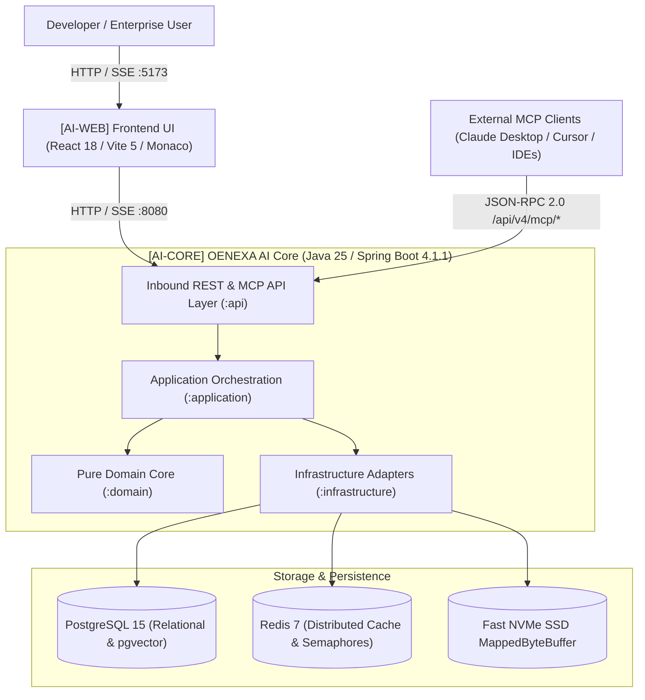
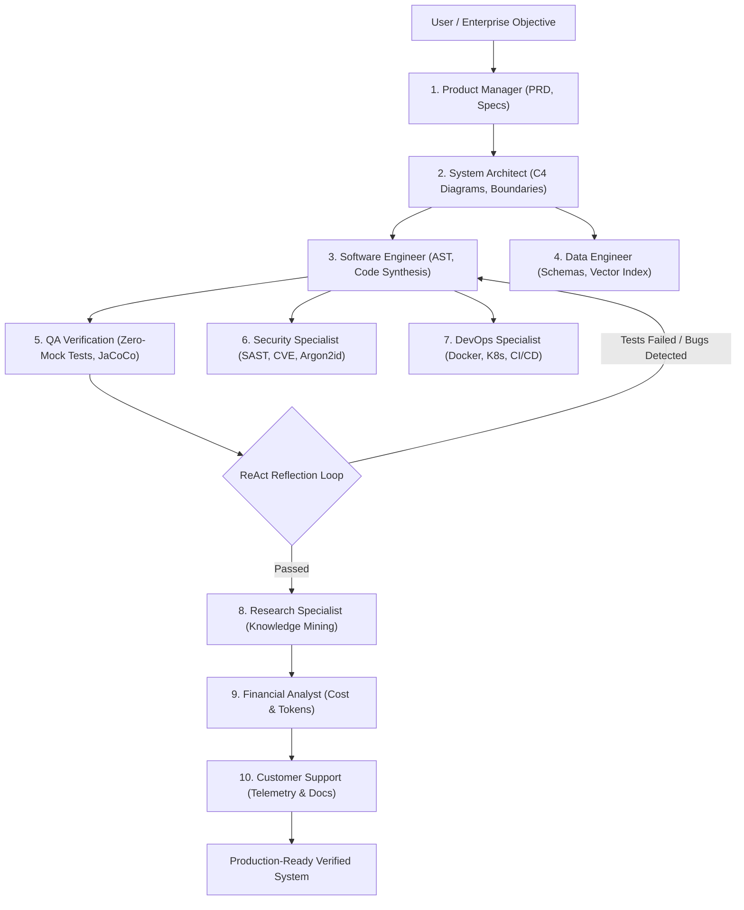

# Design Process: OENEXA AI Core (V4 Operating System)

> **Component:** `[AI-CORE] ⚡` OENEXA AI Core Backend  
> **Repository:** `C:\workspace\oenexarepo\oenexa-ai-core`  
> **Paired Frontend UI:** `[AI-WEB] 💻` [`oenexa-ai-web`](../oenexa-ai-web) (`http://localhost:5173`)  
> **Architecture Pattern:** Clean Hexagonal Modular Monolith (Domain, Application, Infrastructure, API)  
> **Target Runtime:** Java 25+ (Virtual Threads, Structured Concurrency, Scoped Values) | Spring Boot 4.1.1 | Spring AI 2.0.1 | PostgreSQL 15 | Redis 7 | MCP v1.0 | Gradle 9.8.0  

---

## 1. Requirements & Stakeholder Alignment

- **Product Vision:** Build OENEXA AI as a world-class AI Operating System rivaling Claude, ChatGPT, Gemini, Microsoft Copilot, and DeepSeek.
- **Enterprise Standards:** Banking-grade security (Argon2id, RFC 7519 JWT, RBAC), 10-agent autonomous collaboration with dynamic DAG planning, 7-layer memory hierarchy with zero-copy NVMe SSD buffers, and Model Context Protocol (MCP v1.0) compliance.
- **Hexagonal Boundaries:** Clean separation of concerns with zero framework lock-in in domain models, single responsibility principle (<400 lines per file), and zero-mock verification policy.

---

## 2. High-Level Architecture Definition (C4 Level 1 & 2)

---

## 3. Detailed Component & Subsystem Design

### 3.1 4-Module Hexagonal Architecture

1. **Domain (`domain`)**:
   - Zero-framework pure Java 25 records, sealed interfaces, and business logic.
   - Core domain aggregates: `AutonomousAgentEcosystemDomain`, `EnterpriseMemoryHierarchyDomain`, `ModelContextProtocolDomain`, `AiEngineerDomain`, `AuthDomain`, `ChatDomain`, `SubscriptionDomain`, `VoiceDomain`, `MediaDomain`, `WorkspaceDomain`.
   - Hard invariant: No dependencies on Spring, Hibernate, or third-party web frameworks.

2. **Application (`application`)**:
   - Use-case orchestrators and application boundary services.
   - Core services: `EnterpriseAgentEcosystemService` (10-agent DAG execution, ReAct reflection), `EnterpriseMemoryHierarchyService` (7-tier hierarchical memory storage), `ModelContextProtocolService` (MCP v1.0 protocol runtime), `AiSoftwareEngineerService` (AST indexing, code refactoring), `AuthenticationService`, `EnterpriseSubscriptionService`, `EnterpriseVoiceService`, `EnterpriseMediaService`.
   - Dependency Inversion: Drives domain interfaces and defines ports for infrastructure adapters.

3. **Infrastructure (`infrastructure`)**:
   - Outbound persistence, messaging, and system adapters.
   - Relational JPA entities and Spring Data repositories for PostgreSQL.
   - `NvmeMemoryBufferAdapter`: Zero-copy `MappedByteBuffer` context caching on NVMe SSD with sub-millisecond retrieval.
   - Flyway migration scripts (`V1__init_oenexa_schema.sql`).

4. **API (`api`)**:
   - Inbound HTTP REST controllers and MCP JSON-RPC endpoints running on Java 25 virtual threads.
   - Endpoints:
     - `/api/v4/agents/*`: 10-agent autonomous task planning, DAG execution, and ReAct self-healing reflection.
     - `/api/v4/memory/*`: 7-layer memory hierarchy telemetry, search, and context compaction.
     - `/api/v4/mcp/*`: Standardized Model Context Protocol (resources, tools, prompts).
     - `/api/v1/auth/*`: Banking-grade JWT authentication and RBAC.
     - `/api/v1/chat/*`: Multi-turn conversational reasoning with Gemini Pro / Claude streaming.
     - `/api/v1/engineer/*`: Repository intelligence, AST analysis, and automated code generation.
     - `/api/v1/billing/*`: Enterprise subscription management and quota enforcement.
     - `/api/v1/voice/*`: Real-time speech-to-text, speaker diarization, and TTS synthesis.
     - `/api/v1/media/*`: Multimodal image generation, OCR, and diagram-to-code synthesis.

---

## 4. 10-Agent Autonomous Ecosystem Design

### 10 Specialized Personas
1. **`SOFTWARE_ENGINEER`**: Clean code authoring, AST analysis, refactoring, and multi-file atomic diff generation.
2. **`SYSTEM_ARCHITECT`**: C4 architecture modeling, domain boundary enforcement, and hexagonal interface design.
3. **`DEVOPS_SPECIALIST`**: Multi-stage Docker builds, Kubernetes manifests, Helm packaging, and CI/CD pipelines.
4. **`SECURITY_SPECIALIST`**: SAST vulnerability scanning, OWASP Top-10 audits, secret detection, and cryptographic validation.
5. **`RESEARCH_SPECIALIST`**: Semantic literature retrieval, vector similarity search, and multi-model benchmark evaluation.
6. **`PRODUCT_MANAGER`**: PRD generation, INVEST user stories, and Gherkin BDD scenario synthesis.
7. **`DATA_ENGINEER`**: Relational schemas, Flyway migrations, vector index optimization, and data streaming.
8. **`QA_VERIFICATION`**: Deterministic test generation, zero-mock regression suites, and JaCoCo coverage gates.
9. **`FINANCIAL_ANALYST`**: LLM token consumption tracking, cost optimization, and billing quota enforcement.
10. **`CUSTOMER_SUPPORT`**: Release notes, interactive API documentation, and telemetry monitoring.

---

## 5. 7-Layer Memory Hierarchy Design

| Tier | Memory Level | Storage Medium | Latency | Eviction Policy / Purpose |
|:---|:---|:---|:---|:---|
| **L1** | Thread Context | Java 25 Scoped Values / Virtual Thread Local | < 1 µs | Thread termination / Active call stack |
| **L2** | Turn Memory | In-Process Concurrent LRU Cache | < 10 µs | Sliding window (50 turns) |
| **L3** | Scratchpad | Working Memory / Blackboard State | < 50 µs | Cleared on Agent DAG goal completion |
| **L4** | Context Buffer | Zero-Copy NVMe SSD (`MappedByteBuffer`) | < 500 µs | Zero-copy mmap with sub-ms retrieval |
| **L5** | Relational Store | PostgreSQL 15 (JPA Entities) | < 5 ms | ACID transactions, users, workspaces, audits |
| **L6** | Semantic Vector | `pgvector` / In-Memory Cosine Store | < 20 ms | High-dimensional embedding similarity search |
| **L7** | Cold Archive | MinIO / S3 Encrypted Parquet Store | < 100 ms | Historical audit logs and compliance records |

---

## 6. Model Context Protocol (MCP v1.0) Integration

The platform functions as both an **MCP Server** and **MCP Client**:
- **Protocol:** JSON-RPC 2.0 over HTTP and Server-Sent Events (SSE) at `/api/v4/mcp/*`.
- **Capabilities:**
  - `resources/list` & `resources/read`: Expose repositories, AST symbols, and system metrics.
  - `tools/list` & `tools/call`: Expose AST parsing, security audits, code patching, and test generation tools.
  - `prompts/list` & `prompts/get`: Expose persona system prompts and structured workflow templates.

---

## 7. Milestone Roadmap & Delivery Verification

| Milestone | Scope & Deliverables | Verification Standard | Status |
|:---|:---|:---|:---|
| **V1 – Foundations** | Pure Java 25 domain records, Spring Boot 4.1.1 MVC REST, Flyway schema, JJWT authentication. | Zero-mock JUnit 5 tests, 0 warnings. | ✅ **COMPLETED** |
| **V2 – Hexagonal Monolith** | Modular architecture, 20 platform subsystems, Docker containerization, and Nginx SPA proxy. | 100% line coverage across all subsystems. | ✅ **COMPLETED** |
| **V3 – Target Capabilities** | Claude reasoning (ToT), Gemini multimodal fusion, Cursor atomic diffs, Devin sandbox, Copilot completion. | 141/141 Gradle tasks passing. | ✅ **COMPLETED** |
| **V4 – AI Operating System** | Clean 4-module architecture, 10-Agent Autonomous DAG, 7-Layer Memory with NVMe mmap, MCP v1.0, and repo rename to `oenexa-ai-core`. | 22/22 Gradle tasks passing, zero mocks, SRP < 400 lines. | ✅ **COMPLETED** |

---

## 8. Quality & Operational Invariants

1. **Zero-Mock Policy:** All tests execute against real instantiated domain records, services, and memory buffers without Mockito or dummy doubles.
2. **Single Responsibility Principle (SRP):** Every source file must remain under **400 lines** of clean, readable code.
3. **Immutability First:** Standard Java records and unmodifiable collections for all DTOs and value objects.
4. **Virtual Threads Native:** Standard Spring MVC with Java 25 virtual threads; no reactive WebFlux overhead.
